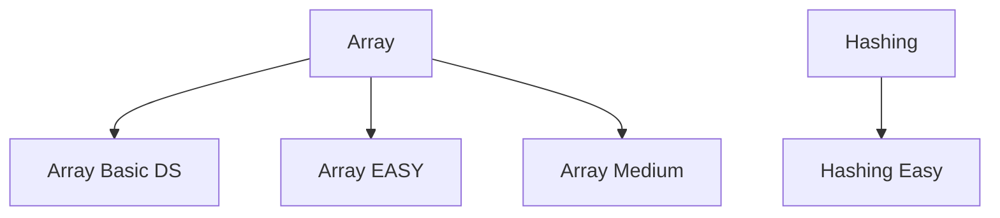

## 1. Stack
- Language: C++ (README.md)
- No package manifest present at repo root (no package.json / go.mod / pyproject.toml / Cargo.toml)
- No build system or framework; each file compiles standalone via `g++` (README.md "How to Use")
- Dependencies: none declared; standard library only (no manifest found)

## 2. Directory map

| path | what lives there |
|---|---|
| Array/ | Array-topic .cpp solutions (39 files, per README.md), split into 3 difficulty subfolders |
| Array/Basic Array DS/ | 10 basic array .cpp solutions (reverse, merge, subarrays, etc.) |
| Array/EASY/ | 29 easy-level array .cpp solutions |
| Array/Medium/ | 10 medium-level array .cpp solutions |
| Hashing/ | Hash-based .cpp solutions (18 files, per README.md) |
| Hashing/Easy/ | 18 easy-level hashing .cpp solutions |

## 3. Diagram

## 4. Component index
- [[Array]]
- [[Array Basic DS]]
- [[Array EASY]]
- [[Array Medium]]
- [[Hashing]]
- [[Hashing Easy]]

## 5. Entry points
- No app entry point: this is a collection of independent, self-contained .cpp files, each with its own `main()` (README.md: "Each file is self-contained with a `main()` function for testing.")
- Run any solution: `g++ -o solution "Problem Name.cpp" && ./solution` (README.md "How to Use")
- TODO: verify — no main.*/index.*/app.* file exists at repo root, src/, or app/

## 6. Conventions (observed only)
- Files are grouped by topic folder (Array, Hashing), then by difficulty subfolder (Basic Array DS / EASY / Medium under Array; Easy under Hashing)
- Filenames are descriptive problem-statement titles ending in `.cpp`, spaces allowed (e.g. `Two Sum Pair with given Sum.cpp`)
- Near-duplicate filenames exist within a folder (e.g. Array/EASY has both `FInd The Missing Number.cpp` and `Find The Misssing Number.cpp`) — TODO: verify intent
- No shared header/util files, README, or build config found inside any topic/difficulty subfolder

## 7. Where things go
- Add a new easy array problem: create a new `.cpp` file in `Array/EASY/`, named after the problem statement
- Add a new medium array problem: create a new `.cpp` file in `Array/Medium/`
- Add a new hashing problem: create a new `.cpp` file in `Hashing/Easy/` (only difficulty folder present under Hashing)
- Add a new topic (e.g. Linked List, Trees): create a new top-level folder at repo root mirroring the Array/Hashing layout, and add it to README.md's Contents table
- Add a new difficulty tier to an existing topic: create a new subfolder under that topic (mirroring Array's Basic Array DS/EASY/Medium split)
