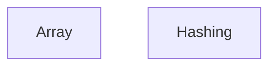

# Data-Structure- Architecture

## 1. Stack
- Language: C++ (per README.md, "implemented in C++")
- No build system / package manager manifest present (no package.json, go.mod, pyproject.toml, or Cargo.toml at repo root)
- No framework or third-party libraries observed
- Compiler: GCC 7+ recommended (README.md, Prerequisites)
- Each .cpp file is standalone with its own `main()` (README.md, "How to Use", line 88)

## 2. Directory map

| path | what lives there |
|---|---|
| Array/ | Top-level folder for array-based problems (39 problems per README.md) |
| Array/Basic Array DS/ | 10 basic array manipulation solutions (reverse, merge, dedupe, subarrays) |
| Array/EASY/ | 29 easy-difficulty array problem solutions |
| Array/Medium/ | Medium-difficulty array problem solutions (2 sum, rotated-array search, swaps) |
| Hashing/ | Top-level folder for hash-based problem solutions (18 problems per README.md) |
| Hashing/Easy/ | 18 easy-difficulty hashing solutions (hash map/set based) |
| README.md | Problem index (Contents + per-topic tables) and usage instructions |

## 3. Diagram

No edges observed — each solution file is self-contained (README.md, line 88) with no imports/includes read across files; the two folders are independent problem categories, not interacting components.

## 4. Component index
- [[Array]]
- [[Hashing]]

## 5. Entry points
- No single dev/prod entry point exists — no manifest, no main.*/index.*/app.* file at repo root, in src/, or in app/.
- Per-file compile (README.md, "How to Use"): `g++ -o solution "Problem Name.cpp"` then `./solution`, run from inside the relevant topic folder (e.g. `Array/EASY/`).
- Each .cpp file supplies its own `main()` for standalone testing (README.md, line 88).

## 6. Conventions
- Files are grouped by topic first (Array, Hashing), then by difficulty subfolder (Basic Array DS / EASY / Medium under Array; Easy under Hashing) — observed from directory listing.
- Filenames are descriptive Title Case with spaces, one problem per file (e.g. "Maximum Subarray Sum – Kadane's Algorithm.cpp") — observed from directory listing.
- Filename inconsistencies exist in the tree as-is: near-duplicate files with typo/casing variants, e.g. `Array/EASY/FInd The Missing Number.cpp` vs `Array/EASY/Find The Misssing Number.cpp`, and `Array/EASY/ Sum of all Subarrays.cpp` (leading space) vs `Array/EASY/Sum of All subarrays.cpp` — observed from directory listing, not corrected here.
- The same problem name (`Duplicate within k distance in an array.cpp`) appears once under `Array/EASY/` and once under `Hashing/Easy/` — observed from directory listing.
- README.md maintains a manual problem index (Contents tables) describing each file's technique — observed from README.md.

## 7. Where things go
- Add a new Array problem -> new .cpp file in `Array/Basic Array DS/`, `Array/EASY/`, or `Array/Medium/` per difficulty, following existing Title Case naming; add a row to README.md's Array Problems table.
- Add a new Hashing problem -> new .cpp file in `Hashing/Easy/` (or a new difficulty subfolder mirroring Array/'s pattern); add a row to README.md's Hashing Problems table.
- Add a new topic (e.g. LinkedList, Trees) -> new top-level folder at repo root with its own difficulty subfolders, following the Array/Hashing pattern; add a new row to README.md's Contents table and a new node in this file's diagram + Component index, plus a matching component note.
- Update problem documentation -> edit the relevant table in README.md to match added/renamed/removed files.
