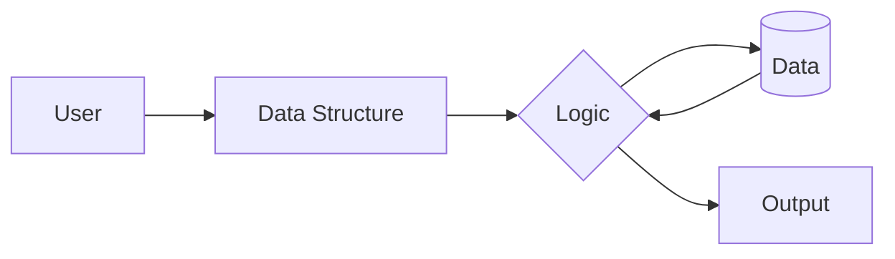

# Data Structures - Problem Solutions

A curated collection of data structure problems and solutions implemented in **C++**, organized by topic and difficulty level.

## Architecture / How it Works




---

## Contents

| Folder | Description | Key Concepts |
|--------|-------------|--------------|
| **Array** | Array-based problems split into Basic and Easy categories | Subarrays, sorting, searching, two pointers, prefix sums |
| **Hashing** | Hash-based problem solutions (Easy level) | Hash maps, frequency counting, pair finding, set operations |

---

## Array Problems (39 problems)

### Basic Array DS (10 problems)

| Problem | Technique |
|---------|-----------|
| Maximum Subarray Sum (Kadane's Algorithm) | Dynamic Programming |
| Move All Zeros to End | Two Pointers |
| Remove Duplicates from Sorted Array | In-place modification |
| Merge Two Sorted Arrays | Two Pointers |
| Generating All Subarrays | Brute Force / Enumeration |
| Minimum Cost to Make Array Size 1 | Greedy |
| Min Increments to Make Equal | Math / Greedy |

### Easy Array Problems (29 problems)

| Problem | Technique |
|---------|-----------|
| Two Sum / Pair with Given Sum | Hash Map |
| Find the Missing Number | Math / XOR |
| Missing and Repeating in Array | Math / Hashing |
| Union / Intersection of Arrays | Sorting / Hashing |
| Maximum Product Subarray | Dynamic Programming |
| Chocolate Distribution Problem | Sorting / Greedy |
| Equilibrium Index | Prefix Sum |
| Segregate 0s and 1s / Even and Odd | Two Pointers |
| Rearrange Positive and Negative Numbers | Partitioning |
| Stock Buy and Sell (Multiple Transactions) | Greedy |
| Sorted Subsequence of Size 3 | Tracking Min/Max |
| Sort Array in Wave Form | Sorting |
| Duplicate Within K Distance | Hashing / Sliding Window |

---

## Hashing Problems (18 problems)

| Problem | Technique |
|---------|-----------|
| Two Sum / Count Pairs with Given Sum | Hash Map |
| Union of Two Arrays | Hash Set |
| Check if Two Arrays are Equal | Frequency Map |
| Check if Array is Subset of Another | Hash Set |
| Most Frequent Element in Array | Frequency Count |
| Max Distance Between Two Occurrences | Hash Map |
| Find Missing Elements of a Range | Hash Set |
| Count Maximum Points on Same Line | Hash Map + Math |
| Count Pairs with Absolute Difference K | Hash Map |
| Check for Disjoint Arrays | Hash Set |
| Minimum Subsets with Distinct Elements | Frequency Count |
| Remove Min Elements (No Common Elements) | Hash Set |
| Duplicate Within K Distance | Sliding Window + Hash Set |
| Find Pair with Sum in Different Rows | Hash Map |

---

## Prerequisites

- C++ compiler (GCC 7+ recommended)
- Basic understanding of time and space complexity

## How to Use

1. Clone the repository:
   ```bash
   git clone https://github.com/ALPHAMAN-0/Data-Structure-.git
   ```
2. Navigate to a topic folder (e.g., `Array/EASY/`).
3. Compile and run any solution:
   ```bash
   g++ -o solution "Problem Name.cpp"
   ./solution
   ```
4. Each file is self-contained with a `main()` function for testing.
5. Run the tests for a selection of the solutions (from the repository root):
   ```bash
   g++ -std=c++17 tests/solutions_tests.cpp -o tests/solutions_tests.out && ./tests/solutions_tests.out
   ```
